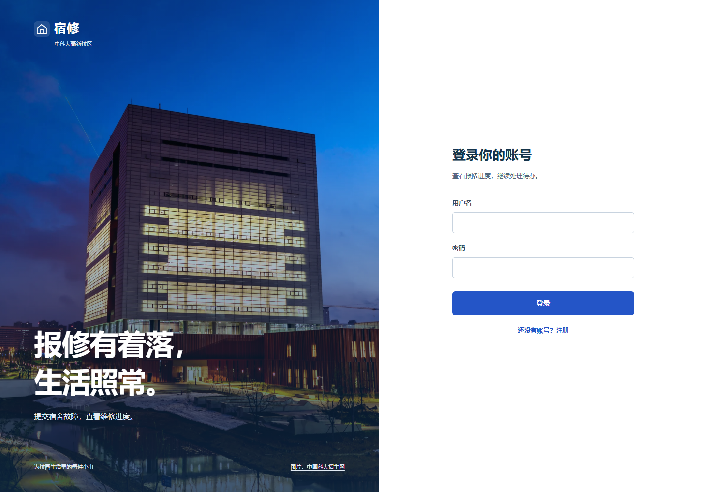

# 宿修 · 校园宿舍报修与智能工单管理系统

以中科大高新校区为场景的宿舍报修项目。学生提交报修，管理员确认分类并派单，维修人员处理，学生验收与评价。独立 AI 服务提供本地故障文本分类。浏览器界面支持电脑和手机。



校园照片来自中国科大招生网，详见[照片来源](docs/image-credits.md)。

## 本地启动

要求 Python 3.12。PowerShell 在项目目录运行：

```powershell
python -m venv .venv
.\.venv\Scripts\python.exe -m pip install -r requirements.lock
.\.venv\Scripts\python.exe scripts/dev.py --seed
```

打开 <http://127.0.0.1:8000>。首次启动生成不入库的 `.env`，终端输出新建演示账号的随机密码。也可以在本地 `.env` 查看 `DEMO_PASSWORD`。账号为 `student`、`student2`、`admin`、`repair`。已有账号密码不会被初始化命令覆盖。`Ctrl+C` 关闭后端、AI API 和 worker。

本地默认 SQLite；正式部署提供 MySQL 8.4。管理员及维修人员注册需要 `.env` 内相应邀请码，学生可直接注册。

## 功能

- 身份认证、角色控制、账号停用、修改密码、登录限速、操作审计。
- 报修、现场及维修图片、历史查询、时间安排、派单和重派、状态跟踪、返修、验收、评价。
- 带版本号的乐观并发校验，过期操作返回409。
- WebSocket 实时看板，按楼栋、类别、日期筛选，多维统计及安全 CSV 导出。
- 本地五分类模型、独立服务令牌、置信度过滤、断线重试、人工确认与修正。
- 图片授权读取、实际格式检查、大小限制、重新编码去除元数据；AI 不接收图片或视频。

## 验证

```powershell
.\.venv\Scripts\python.exe -m pip install -r requirements-dev.txt
.\.venv\Scripts\python.exe -m pytest -q
.\.venv\Scripts\python.exe -m ai_service.classifier
.\.venv\Scripts\python.exe scripts/export_contract.py
```

训练数据是300条模拟描述，按故障组划分，改写不跨训练和测试集合。实际指标见 [AI评估记录](docs/ai-metrics.json)。完整安装版本见 `requirements.lock`。

## 项目文档

| 文档 | 内容 |
|---|---|
| [需求规格](docs/requirements.md) | 范围、角色、用例与验收标准 |
| [指导书对照](docs/traceability.md) | 原指导书要求与报修业务的逐项对应 |
| [设计说明](docs/design.md) | 架构、MVC/MVVM、ER、状态与顺序图 |
| [接口说明](docs/api.md) | 认证方式、错误码、接口与时间约定 |
| [OpenAPI](docs/openapi.json) | 可机读接口契约，在线 `/docs` |
| [部署说明](docs/deployment.md) | 本地、MySQL Compose、备份、HTTPS |
| [用户手册](docs/user-manual.md) | 学生、管理员、维修人员操作 |
| [测试用例与记录](docs/testing.md) | 自动化、安全、UI、性能验证 |
| [演示脚本](docs/demo.md) | 中文配音、实际浏览器操作与录制流程 |
| [界面设计](docs/ui-design.md) | 工作台、文案、响应式与交互规范 |
| [验证明细](docs/verification.json) | 实际测试与环境限制，机器可读 |

实验报告以 PDF 和 LaTeX 源码独立提交。

## 项目结构

```text
app/          主后端、业务服务、数据模型、浏览器客户端
ai_service/   分类数据、模型训练、推理 API、独立入库 worker
tests/        单元与接口/集成安全测试
scripts/      本地启动、契约导出、在线验收与浏览器验证
database/     MySQL 建表脚本
docs/         需求、设计、测试与部署资料
.github/      自动测试和 MySQL Compose 验收流水线
```

## 中文解说演示

[观看演示](deliverables/宿修-中文解说演示.mp4)。从空工单环境开始，依次展示提交、分类、派单、维修、返修、验收、评价、筛选与导出。录屏对应的三张工单通过浏览器操作创建。

独立录制环境不会改动日常数据库：

```powershell
.\.venv\Scripts\python.exe -m pip install -r requirements-video.txt
.\.venv\Scripts\python.exe scripts/demo_session.py
# 另一个终端
.\.venv\Scripts\python.exe scripts/record_demo.py
```

剪辑素材、配音和字幕位于本地 `deliverables/demo-source/`。解说使用中文合成语音，播放文件为 H.264 / AAC MP4。
