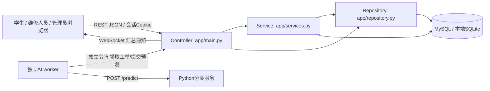
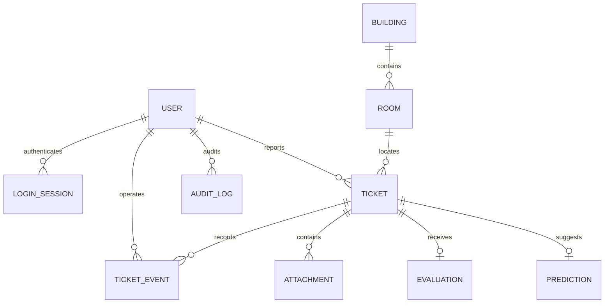
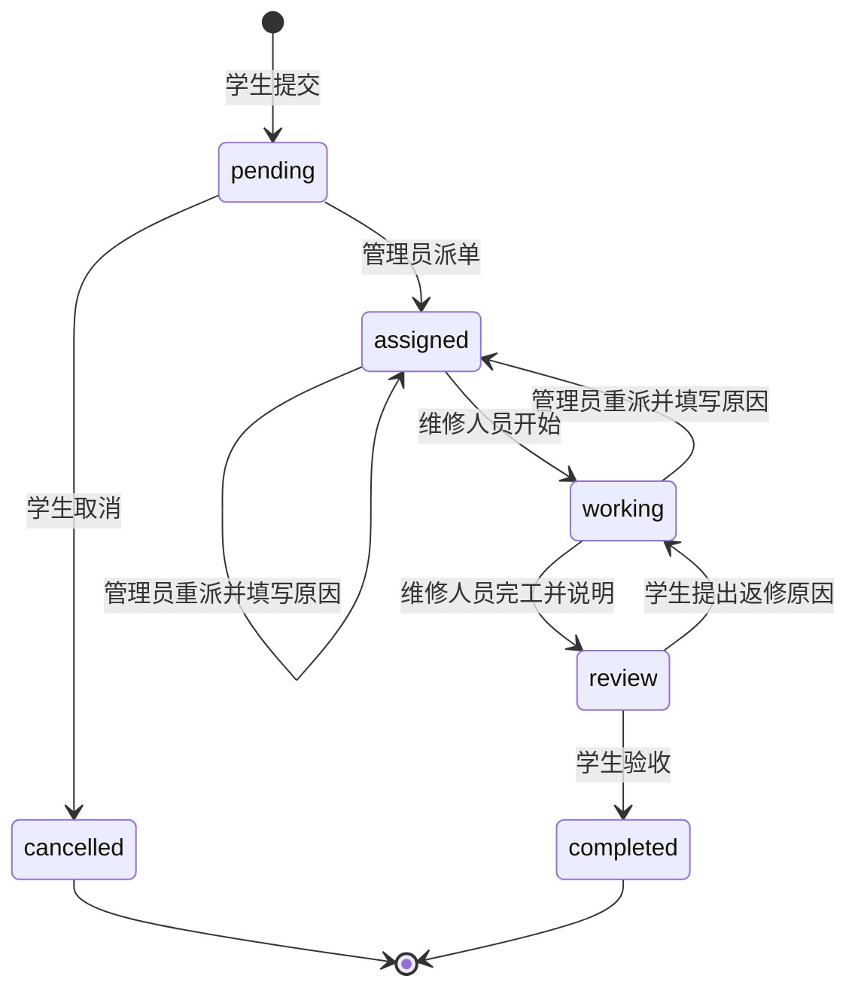
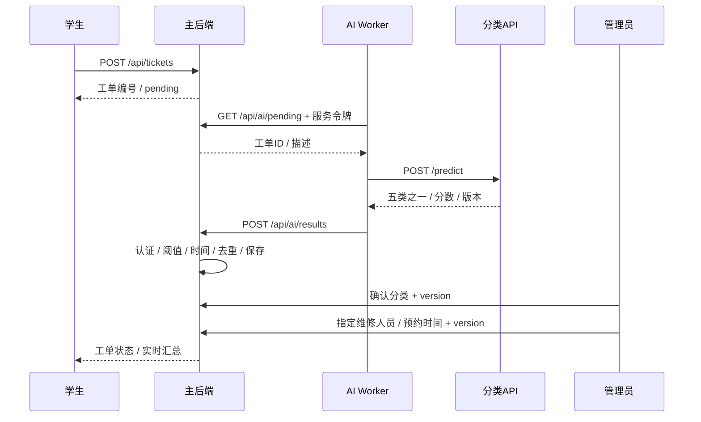

# 系统设计说明

## 总体架构与修改版MVC

浏览器实现学生、维修人员和管理员的不同工作区。主后端是统一业务入口，AI API与worker独立部署。浏览器采用B/S；worker作为客户端，通过HTTP调用AI和主后端构成C/S服务交互。没有开发原生Android应用，符合指导书允许浏览器客户端的选项。

修改版MVC的分工：Model包括关系模型和业务规则；View是HTML/CSS及纯渲染函数；Controller接收交互并调用API；后端Controller负责验证与认证，Service负责状态转换、统计、导出，Repository负责权限范围查询。认证、基础信息等简短CRUD由Controller直接调用ORM，复杂工单规则集中于Service，避免为每个CRUD增加空转发层。

浏览器内部采用MVP式职责分离：`model.js`保存页面状态和API Repository；`view.js`只根据数据生成界面；`controller.js`承担Presenter职责，处理导航、表单和异步结果。没有将使用某个前端框架视为架构成立的条件。

## 数据模型

维修负责人也是User外键，必须是启用的technician。预约时间存于Ticket；历史派单人选、时间和原因写入Event。事件从不通过业务接口修改或删除。房间关联楼栋。评价和预测均对ticket_id唯一，防止重复写入。模型含字段和约束的完整定义见`app/models.py`及`database/schema.mysql.sql`。

所有时间在服务端使用UTC无时区字段。输入带时区的预约时间转换为UTC；前端显示浏览器本地时区。导出时间为UTC。生产数据库连接建议统一UTC服务器时区。

## 工单状态

活跃工单允许补充说明；管理员可确认分类。已完成/已取消状态不允许补充图片和更改分类。完成工单允许一次评价。每次动作提交version，数据库以`WHERE id=:id AND version=:version`更新；冲突返回409并回滚，事件在同一事务内保存。

## 核心交互

## 质量属性与取舍

| 属性 | 实现与约束 |
|---|---|
| 安全 | bcrypt、随机会话令牌仅保存SHA-256摘要、HttpOnly Cookie、8小时有效期、后端RBAC与行范围控制 |
| 一致性 | 版本条件更新；状态与事件同事务；评价及预测唯一约束 |
| 可用性 | 工单提交不等待AI；AI失败退避重试；低分人工分类；WebSocket断开后浏览器自动重连 |
| 隐私 | AI仅取得工单描述；业务图片重新编码清除EXIF，并校验工单可见性；原始人脸视频不采集 |
| 可维护性 | 业务服务、数据访问、页面职责及AI模块分离；契约可导出；依赖锁定 |
| 性能 | 分页、常用条件索引；轻量本地模型；实时通知每3秒；当前统计为课程小规模设计 |

统计口径：未完成排除completed和cancelled；完工时长为创建至最终验收完成；返修耗时计入；按创建日期归组；没有样本的平均值返回null并显示“—”。筛选的时间范围包含两端。

当前限制：列表序列化存在小规模多次关联查询，统计以应用内聚合实现；大规模场景应改为数据库聚合、批量关联查询和增量通知。AI模型只在模拟描述上评估，其他类是指定场景的剩余类，不具备开放世界识别保证。

技术参考：[FastAPI安全机制](https://fastapi.tiangolo.com/tutorial/security/first-steps/)、[SQLAlchemy会话事务](https://docs.sqlalchemy.org/en/20/orm/session_basics.html)。
